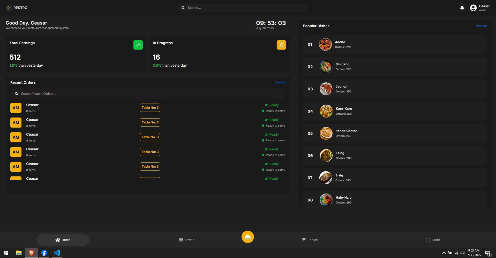

<p align="center">
  
</p>

<h1 align="center">🧾 RESTRO POS SYSTEM</h1>

<p align="center">
  A modern, full-stack Point of Sale system for restaurants and cafes — built with ❤️ using the MERN stack and Tailwind CSS.
</p>

<p align="center">
  
  
  
  
</p>

---

## 🖥️ Features

- 📋 Product & Category Management
- 🛒 Order and Cart System
- 👨‍🍳 Staff & Role Permissions
- 📈 Sales Dashboard & Analytics
- 💾 Offline-first design (Coming Soon)
- 🔐 Secure login and JWT auth

---

## 🧰 Tech Stack

| Frontend      | Backend       | Database   | Styling        |
|---------------|---------------|------------|----------------|
| React.js      | Node.js       | MongoDB    | Tailwind CSS   |
| React Router  | Express.js    | Mongoose   | PostCSS        |

---

## 📸 Screenshots



---

## 🚀 Getting Started

### 🔧 Prerequisites

- Node.js v20+
- MongoDB
- npm or yarn

---

### 📦 Installation

```bash
# Clone the repo
git clone https://github.com/your-username/restro-pos.git
cd restro-pos

# Install dependencies for client and server
cd client
npm install

cd ../server
npm install
